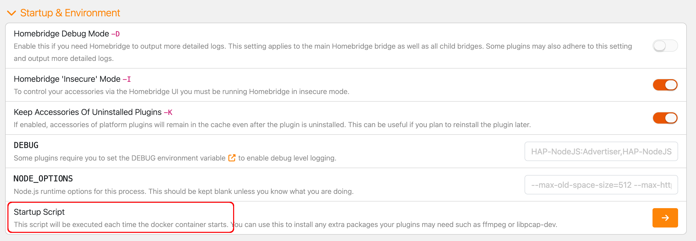
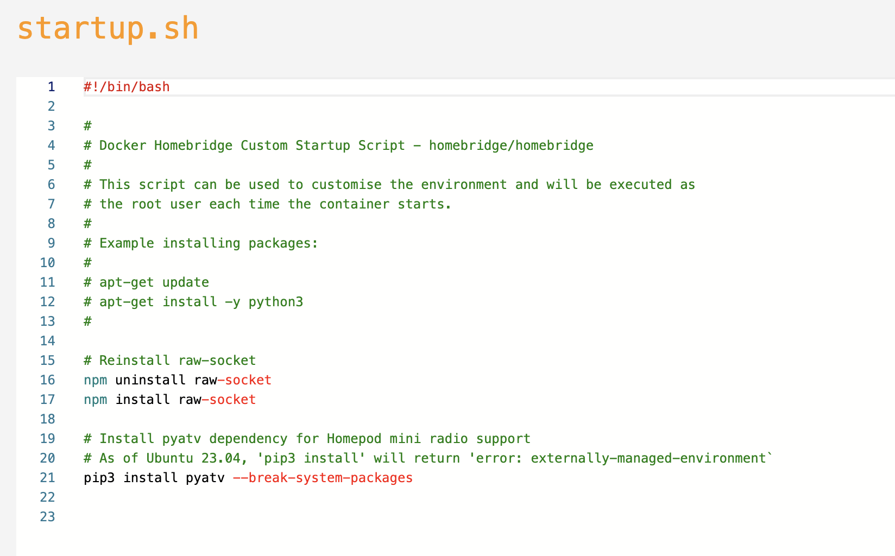

<div align="center">

# Homebridge Docker

[](https://github.com/homebridge/docker-homebridge/actions/workflows/release-stage-2_build_and_push_docker_images.yml)
[](https://hub.docker.com/r/homebridge/homebridge/)
[](https://discord.gg/Cmq8a44)

**Official Docker image for [Homebridge](https://github.com/homebridge/homebridge)** - Emulate the iOS HomeKit API on your network

</div>

---

## 📢 Important Update

We have migrated the official Homebridge Docker image from **`oznu/homebridge`** to **`homebridge/homebridge`**.  
Please update your configurations to use the new image location for the latest updates and features.

---

## 🚀 Quick Start

### Prerequisites
- Docker Engine with networking access
- Host network mode support (**required for HomeKit**)

> ⚠️ **Compatibility Note**: This image does **not** work with Docker Desktop for Mac or Windows due to networking limitations ([details](https://github.com/homebridge/docker-homebridge/issues/570)).

---

## 📦 Available Images

This is a **multi-architecture** image supporting x86_64 and ARM64v8 platforms, plus ARM32v7 on images not yet moved to Ubuntu 26.04 (see below). Images are built on Ubuntu 26.04 or 24.04 depending on the release stream, and Ubuntu 22.04 for `synology`.

**Ubuntu 26.04 rollout and 32-bit ARM:** During fall 2026, every Homebridge Docker image except `synology` moves to Ubuntu 26.04, one release stream at a time. Node.js no longer publishes 32-bit builds, so images based on Ubuntu 26.04 no longer include the `arm32v7` (32-bit ARM) architecture. If you run Homebridge in Docker on a 32-bit ARM device, move to a 64-bit (`arm64v8`) OS to keep receiving updates. Images already published stay available under their dated tags (for example `2026-10-23`).

| Image Tag | Architectures | Release Type |
| :--- | :--- | :--- |
| `latest`, `ubuntu` | `amd64`, `arm32v7`*, `arm64v8` | Stable |
| `synology` | `amd64`, `arm32v7`, `arm64v8` | Stable |
| `beta` | `amd64`, `arm64v8` | Beta |
| `alpha` | `amd64`, `arm64v8` | Alpha |
| `legacy` | `amd64`, `arm32v7`*, `arm64v8` | Legacy |

\* `arm32v7` is dropped when that release stream moves to Ubuntu 26.04. `synology` stays on Ubuntu 22.04 and is not part of this rollout.

Which tag to use:

- `latest` (or `ubuntu`, the same image): the stable release. Use this one unless you have a reason not to.
- `beta` and `alpha`: pre-release versions of Homebridge and the Homebridge UI, for testing.
- `legacy`: Homebridge 1.x, for plugins that do not work with Homebridge 2 yet. It gets no new Homebridge features. Move to `latest` when your plugins support Homebridge 2.
- `synology`: the stable release built on Ubuntu 22.04, for Synology NAS (see the [Synology guide](https://github.com/homebridge/docker-homebridge/wiki/Homebridge-on-Synology)).

**Beta and alpha may include features not yet in `latest`.** When they do, the release notes for that build have a **Pre-release Changes** section listing them and the branch the image was built from.


---

## 🛠️ Installation

### Using Docker Compose (Recommended)

Create a `docker-compose.yml` file:

```yaml
services:
  homebridge:
    image: homebridge/homebridge:latest
    restart: always
    network_mode: host
    hostname: homebridge      # Optional: Set container hostname
    volumes:
      - ./volumes/homebridge:/homebridge
    environment:
      - TZ=America/Toronto  # Optional: Set your timezone
      - ENABLE_AVAHI=1      # Optional: Enable/disable Avahi (1=enabled, 0=disabled)
    stop_grace_period: 30s  # Optional: give Homebridge time to shut down cleanly
    logging:
      driver: json-file
      options:
        max-size: '10m'
        max-file: '1'
```

Start the container:

```bash
docker compose up -d
```

### Using Docker CLI

```bash
docker run -d \
  --restart=always \
  --net=host \
  --name=homebridge \
  -e TZ=America/Toronto \
  -v $(pwd)/homebridge:/homebridge \
  homebridge/homebridge:latest
```

> **Good to know**: the services in the container run as `root`, and the container uses the network of the host. HomeKit needs the host network to find Homebridge. To run Homebridge itself as another user, see [Running as a non-root user](#running-as-a-non-root-user).

---

## ⚙️ Configuration

### Required Parameters

| Parameter | Docker Compose | Docker CLI | Description |
|:----------|:---------------|:-----------|:------------|
| Network Mode | `network_mode: host` | `--net=host` | **Required** - Enables host networking for HomeKit discovery |
| Volume Mount | `volumes:` | `-v /path:/homebridge` | **Required** - Persistent storage for config and plugins |

### Optional Parameters

| Parameter | Docker Compose | Docker CLI | Default | Description |
|:----------|:---------------|:-----------|:--------|:------------|
| Hostname | `hostname: homebridge` | `--hostname=homebridge` | Container ID | Set custom hostname for the container |
| Timezone | `environment:`<br/>`- TZ=America/Toronto` | `-e TZ=America/Toronto` | `UTC` | Set timezone ([list](https://en.wikipedia.org/wiki/List_of_tz_database_time_zones)) |
| Avahi mDNS | `environment:`<br/>`- ENABLE_AVAHI=1` | `-e ENABLE_AVAHI=1` | `1` | Set to `0` to disable Avahi mDNS service |
| Avahi host name | `environment:`<br/>`- DSM_HOSTNAME=mynas` | `-e DSM_HOSTNAME=mynas` | unset | Host name that Avahi announces. Needed on some Synology DSM systems ([details](https://github.com/homebridge/docker-homebridge/issues/35)) |
| Start banner | `environment:`<br/>`- NO_BANNER=1` | `-e NO_BANNER=1` | unset | Set to `1` to hide the table of versions printed at each start |
| Run as user | `environment:`<br/>`- HOMEBRIDGE_RUN_AS_USER=1` | `-e HOMEBRIDGE_RUN_AS_USER=1` | unset (`root`) | Run the Homebridge service as the `homebridge` user instead of `root` ([details](#running-as-a-non-root-user)) |
| User / Group | `environment:`<br/>`- PUID=1000`<br/>`- PGID=1000` | `-e PUID=1000 -e PGID=1000` | `homebridge` account ids | Optional uid / gid for the `homebridge` user; requires `HOMEBRIDGE_RUN_AS_USER=1` ([details](#running-as-a-non-root-user)) |

> **Note**: When running with `ENABLE_AVAHI=0`, you can mount the host's mDNS service to enable mDNS usage in the container:
> ```yaml
> volumes:
>   - ./volumes/homebridge:/homebridge
>   - /var/run/dbus:/var/run/dbus  # Mount host D-Bus socket
>   - /var/run/avahi-daemon/socket:/var/run/avahi-daemon/socket  # Mount host Avahi socket
> ```

### Health and failed starts

- The image has a built-in health check. `docker ps` shows `healthy` when the Homebridge UI answers, and `unhealthy` when it has not answered for about five minutes. The check reads the UI port from your `config.json`, so it keeps working when you change the port.
- If the start-up of the container fails (for example because the data folder is mounted at the wrong path), the container **stops** with an error in its log. With `restart: always` Docker starts it again. Read the reason with `docker logs homebridge`.

---

### Running as a non-root user

By default the Homebridge service runs as `root`. Set `HOMEBRIDGE_RUN_AS_USER=1` to run it
as the `homebridge` user created by the Homebridge package instead.

Optionally set `PUID` / `PGID` to change that user's uid / gid, so files in the data volume
(`-v` flags) are owned by a matching user on the host:

```yaml
services:
  homebridge:
    image: homebridge/homebridge:latest
    environment:
      - HOMEBRIDGE_RUN_AS_USER=1
      - PUID=1000
      - PGID=1000
```

To find your ids, use `id <user>`:

```
$ id dockeruser
uid=1000(dockeruser) gid=1000(dockergroup) groups=1000(dockergroup)
```

When `HOMEBRIDGE_RUN_AS_USER` is enabled:

* `/homebridge`, `/opt/homebridge` and `/home/homebridge` are chowned to the `homebridge` user on every start
* Homebridge, the Homebridge UI and the plugin install performed on start-up all run as that user
* `PUID` and `PGID` are applied independently; a value that is `0`, not numeric, or already
  used by another account or group inside the container is ignored with a warning

`PUID` / `PGID` are ignored when `HOMEBRIDGE_RUN_AS_USER` is not enabled.

Homebridge falls back to running as `root` if:

* the ownership of `/homebridge` or `/opt/homebridge` cannot be changed (for example an NFS
  volume mounted with `root_squash`)
* the Homebridge UI is configured to listen on a privileged port (below `1024`)

> **Note**: while running as the `homebridge` user, that user is granted passwordless `sudo`
> (via `/etc/sudoers.d/010_homebridge-nopasswd`), which the Homebridge UI needs in order to
> restart the container and to update Homebridge, the UI and Node.js. Remove it from your
> [startup script](#-custom-startup-script) with
> `rm -f /etc/sudoers.d/010_homebridge-nopasswd` if you would rather not have it.

> **Note**: the custom startup script (`/homebridge/startup.sh`) always runs as `root`. Anything
> it writes into `/homebridge` should be chowned to the `homebridge` user by the script itself.

---

## 🖥️ Homebridge UI

Access the **Homebridge UI** at `http://<your-server-ip>:8581`

The UI allows you to:
- ✅ Install, update, and remove plugins
- ✅ Edit Homebridge configuration
- ✅ View logs and restart Homebridge
- ✅ Manage accessories and bridges

<p align="center">
  
</p>

---

## 🔧 Custom Startup Script

For advanced customization, use the **Startup Script** feature in the UI (`Settings` → `Startup & Environment`).

<p align="center">
  
</p>

The `startup.sh` script:
- Runs on every container start, as `root`, before Homebridge starts
- Persists across container recreations
- Can install packages, copy files, or execute custom commands
- Must come to an end: Homebridge only starts after the script has finished, so a script that waits for ever keeps Homebridge from starting
- If it ends with an error, a warning is written to the container log and Homebridge starts anyway

**Example:**

```bash
#!/bin/sh

# Install custom Node.js packages
npm install -g some-custom-package

# Install a system package (for Python libraries use the python3-<name> packages:
# Ubuntu does not allow a plain "pip3 install" outside a virtual environment)
apt-get update && apt-get install -y python3-requests

# Copy configuration from host
cp /homebridge/custom-config.json /etc/custom-config.json
```

<p align="center">
  
</p>

---

## ⌨️ Commands Inside the Container

Open a shell in the container with `docker exec -it homebridge bash`, or use the terminal in the Homebridge UI.

| What you want | Command |
|:--------------|:--------|
| Is Homebridge running? | `hb-service status` |
| Show the log | `hb-service logs` |
| Restart Homebridge | Use **Restart** in the Homebridge UI, or `docker restart homebridge` on the host, or `sudo hb-service restart` in the container |
| Stop / start Homebridge and keep the container | `sudo hb-service stop` / `sudo hb-service start` |
| Install or remove a plugin by hand | `sudo hb-service add homebridge-example` / `sudo hb-service remove homebridge-example` |

- `hb-service` (without `sudo`) is the program of the Homebridge UI. `sudo hb-service` is the wrapper of the Homebridge package. Use them as shown in the table.
- There is no systemd in the container. `systemctl` commands do not work here.

---

## 📚 Step-by-Step Guides

- [Running Homebridge with Docker on Linux](https://github.com/homebridge/homebridge/wiki/Install-Homebridge-on-Docker)
- [Running Homebridge on Synology NAS](https://github.com/homebridge/docker-homebridge/wiki/Homebridge-on-Synology)
- [Running Homebridge on Unraid](https://github.com/homebridge/docker-homebridge/wiki/Homebridge-on-Unraid)

---

## 🔄 Updates

### Manual Updates

Pull the latest image and recreate your container:

```bash
docker compose pull
docker compose up -d
```

### Automated Updates

> ⚠️ **Not Recommended**: Automated updates using tools like Watchtower are **strongly discouraged** and done at your own risk

### In-Container Updates

What happens to an update you made inside the container (from the Homebridge UI) when you later update the image:

- **Homebridge**: your version is kept if it is newer than the one in the new image. The image's version is used when it is newer than yours, or when you change release stream (for example from the `beta` tag back to `latest`).
- **Homebridge UI** and **Node.js**: these are part of the image, so the versions of the new image are used.

---

## 🎥 FFmpeg Support

This image includes **FFmpeg** with `libfdk-aac` audio support for camera streaming and video processing.

---

## ✅ Container Validation

Every image is tested **before** it is published. The release workflow builds the image to a test tag first, runs the tests below on `amd64` and on `arm64`, and only copies the image to its public tags when they pass.

The tests ([`test/container/run.sh`](./test/container/run.sh)):
- ✅ Start with a new, empty volume: the Homebridge UI answers and the container becomes `healthy`
- ✅ Start again with an existing volume: an installed plugin is still there
- ✅ Start with a `package.json` that was cut short: the plugins are kept and the file is repaired
- ✅ Update from the image that is public now: the plugin is kept and Homebridge does not move down a version
- ✅ Wrong set-ups (data mounted at the wrong path, a failed start-up): the container stops with a clear error, and no data is deleted
- ✅ Start with Docker Compose and host networking, as in this README

### Manual Validation

To test an image that is already published:

1. Go to [Actions](https://github.com/homebridge/docker-homebridge/actions)
2. Select **"Validate Homebridge Docker Container"**
3. Click **"Run workflow"**
4. Choose the image tag: `latest`, `beta`, `alpha`, `legacy` or `synology`

### Testing a Change Yourself

```bash
test/unit/run.sh                          # tests of the start scripts, no Docker needed
./build-local.sh beta --build-only        # build the beta image as "docker-homebridge"
test/container/run.sh docker-homebridge   # start it and run the container tests
```

---

## 🐛 Troubleshooting

### 1. FFmpeg Issues

FFmpeg with `libfdk-aac` audio support is **included** in this image. No additional installation required.

### 2. Container Won't Start on Older Raspbian

If you see errors like:

```
Node.js[445]: ../src/util.cc:188:double node::GetCurrentTimeInMicroseconds(): Assertion `(0) == (uv_gettimeofday(&tv))' failed.
```

```
s6-svscan: warning: unable to iopause: Operation not permitted
```

Your host OS needs to be updated. See [#434](https://github.com/homebridge/docker-homebridge/issues/434) and [#441](https://github.com/homebridge/docker-homebridge/issues/441) for solutions.

### 3. Get Help on Discord

Join the [Official Homebridge Discord](https://discord.gg/Cmq8a44) and ask in the [#docker](https://discord.gg/Cmq8a44) channel.

---

## 📄 License

Copyright (C) 2024-2026 homebridge  
Copyright (C) 2017-2022 oznu

This program is free software: you can redistribute it and/or modify it under the terms of the GNU General Public License as published by the Free Software Foundation, either version 3 of the License, or (at your option) any later version.

This program is distributed in the hope that it will be useful, but WITHOUT ANY WARRANTY; without even the implied warranty of MERCHANTABILITY or FITNESS FOR A PARTICULAR PURPOSE. See the [GNU General Public License](./LICENSE) for more details.

---

<div align="center">

**Made with ❤️ by the Homebridge community**

</div>